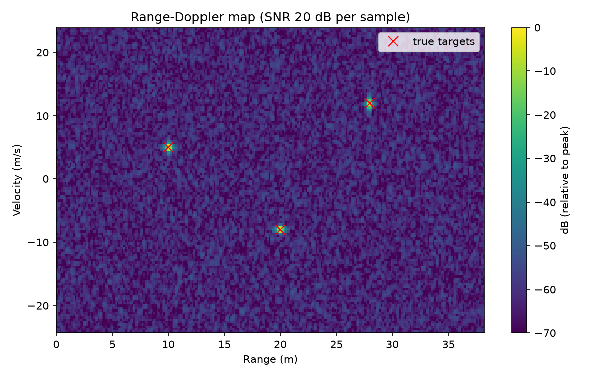
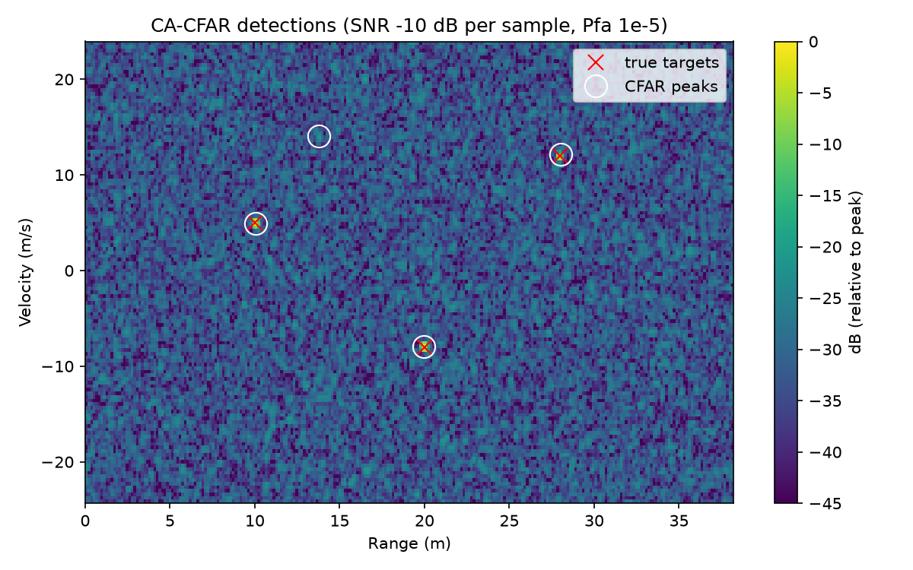
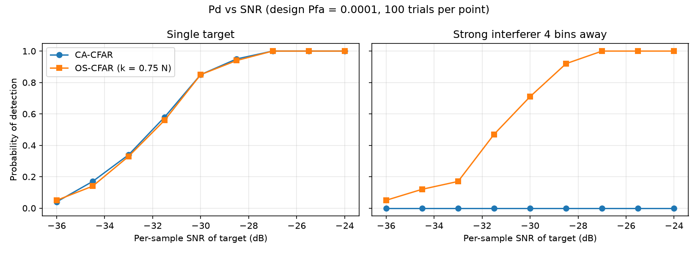
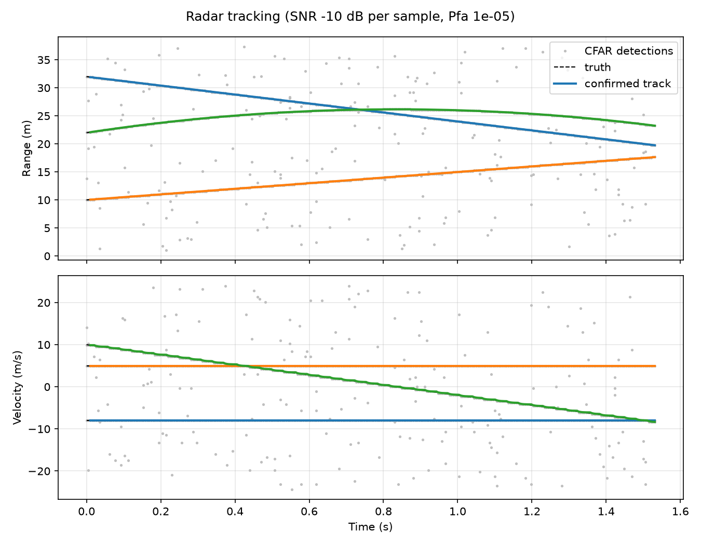

# FMCW Radar Pipeline

Python simulation of an automotive-style FMCW radar chain: beat-signal generation, range-Doppler processing, CFAR detection (CA and OS), and Kalman tracking with data association. Every stage is verified against hand calculations or theory by 27 automated tests.

## Pipeline

chirp/beat signal -> range FFT -> Doppler FFT -> 2D CFAR -> peak extraction -> Kalman tracker (GNN + M-of-N)

## Radar parameters

| Parameter | Value |
|---|---|
| Carrier / bandwidth | 77 GHz / 1 GHz |
| Chirp time / chirps per frame | 40 us / 128 |
| Samples per chirp | 256 (complex I/Q) |
| Range resolution / max range | 0.15 m / 38.4 m |
| Velocity resolution / max velocity | 0.38 m/s / +-24.3 m/s |

## Results

### Range-Doppler map


### CFAR: false-alarm control
Measured vs design Pfa (guard 2, train 4, N = 144 training cells):

| Design Pfa | Rectangular window | Hann window |
|---|---|---|
| 1e-2 | 1.01e-2 | 1.17e-2 |
| 1e-3 | 9.94e-4 | 1.38e-3 |
| 1e-4 | 9.77e-5 | 1.72e-4 |

Without windowing the measured Pfa matches the design within 3%. The Hann window correlates neighbouring bins, which shrinks the effective number of independent training cells and raises the real Pfa, more so at lower Pfa.



### CA-CFAR vs OS-CFAR


In uniform noise the two detectors perform alike. With a strong interferer 4 bins away, CA-CFAR is completely masked (Pd = 0), while OS-CFAR still detects the target, about 1 dB worse than in clean noise.

### Tracking


Three targets (one manoeuvring at -12 m/s^2) in clutter from CFAR false alarms (SNR -10 dB per sample, Pfa 1e-5, 300 frames):

| Target | Tracked | Range RMSE raw -> track | Velocity RMSE raw -> track |
|---|---|---|---|
| 1 | 99.3% | 0.043 -> 0.016 m | 0.057 -> 0.056 m/s |
| 2 | 99.3% | 0.043 -> 0.005 m | 0.015 -> 0.015 m/s |
| 3 (manoeuvring) | 99.3% | 0.045 -> 0.003 m | 0.110 -> 0.089 m/s |

False confirmed tracks: 0 over 300 frames.

Tracking improves range error by roughly 3x to 15x. Velocity gains are small: for constant-velocity targets (1 and 2) the raw velocity error is a fixed quantisation offset, so there is nothing random to average away. The gain appears on the manoeuvring target, where the raw error varies from frame to frame. "Tracked" is capped at 99.3% (298 of 300 frames) because 3 hits are needed to confirm a track.

## Verification
- Stage 1: range/velocity resolution, max range/velocity checked by hand and by test
- Stage 2: beat frequency, Doppler phase, and noise power match theory
- Stage 3: range-Doppler peaks land on the exact true bins
- Stage 4: CA-CFAR alpha = 7.08 for N = 144, Pfa = 1e-3; OS-CFAR alpha verified in closed form for k = 1; measured Pfa within tolerance; masking test
- Stage 5: confirmation after 3 hits, false-alarm rejection, two-target separation, and tracker error below raw error on Gaussian-noise measurements

## Limitations and future work
- Radial motion only (no angle of arrival); range-Doppler coupling ignored
- Detections are bin centres; parabolic peak interpolation would reduce quantisation error
- Simulated data only; gains over raw detections are modest because quantisation dominates the error
- Next: angle estimation with a receive array, 2D tracking, real radar data

## Run
```powershell
python -m venv .venv
.venv\Scripts\Activate.ps1
pip install -r requirements.txt
python -m pytest -v
python -m experiments.plot_rd_map
python -m experiments.cfar_pfa
python -m experiments.plot_cfar
python -m experiments.pd_vs_snr
python -m experiments.track_demo
```